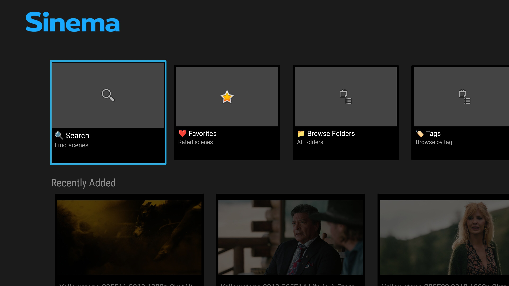
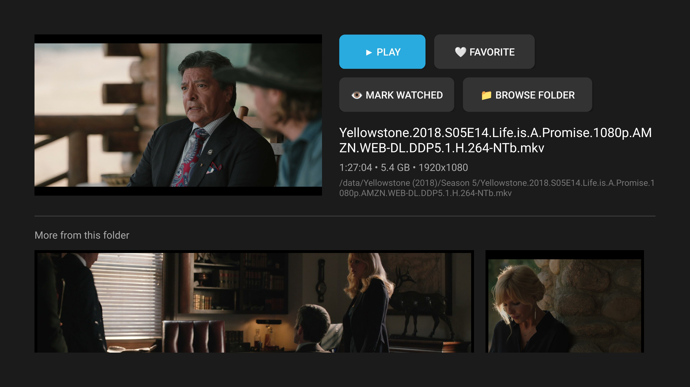
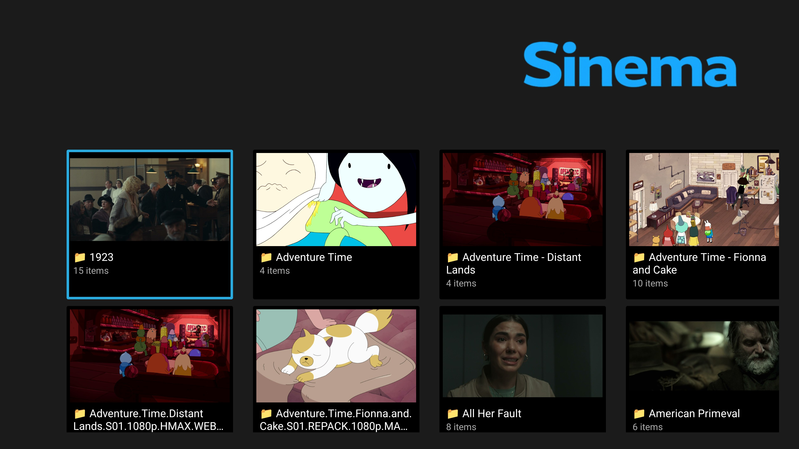
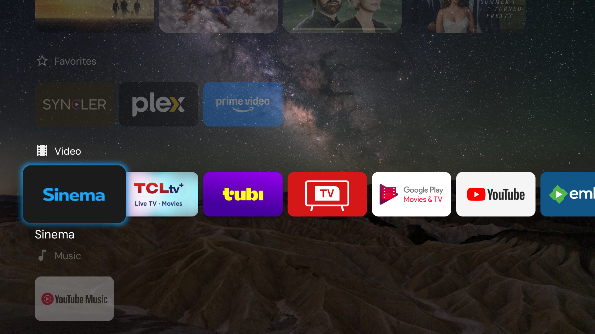

<p align="center">
  
</p>

<p align="center">
  <b>Your private collection deserves a big screen.</b>
  <br />
  An Android TV client for <a href="https://github.com/stashapp/stash">Stash</a> — the self-hosted media organizer you already know and love.
  <br />
  Built for the couch · controlled with a remote · nobody's business but yours.
</p>

<p align="center">
  
  
  
  
  
</p>

---

## Screenshots

| Home Screen | Scene Details | Browse Folders |
|:---:|:---:|:---:|
|  |  |  |

| Android TV Launcher |
|:---:|
|  |

---

## Quick start

### Prerequisites
- A running [Stash](https://github.com/stashapp/stash) server on your network
- An Android TV device (or any Android device with Leanback support)
- Docker (for building) or Android Studio
- ADB access to your TV

### Build
```bash
# Clone the repo
git clone https://github.com/visorcraft/Sinema.git
cd Sinema

# Build with Docker (no Android Studio needed)
docker build -t sinema-builder -f Dockerfile.build .
docker run --rm -v "$(pwd)":/project -v sinema-gradle-cache:/root/.gradle sinema-builder \
  bash -c "cd /project && ./gradlew assembleRelease --no-daemon"
```

### Install
```bash
# Connect to your TV
adb connect <TV_IP>:5555

# Install (use -r to preserve data on updates)
adb -s <TV_IP>:5555 install -r app/build/outputs/apk/release/app-release.apk

# Launch
adb -s <TV_IP>:5555 shell am start -n com.sinema/.ui.MainActivity
```

### First launch
1. Open Sinema on your TV
2. You’ll be guided through a setup wizard with **3 options**:
   - **Sign in to Stash** (username/password) — recommended for most users
   - **Web Setup** — open a temporary browser form from the URL shown on the TV
   - **Manual setup** — enter the server URL + API key directly
3. After setup, Sinema stores settings locally and you can browse immediately.

Notes:
- Stash default port is usually **6969** (e.g. `http://192.168.1.100:6969`).
- If you use the sign-in flow, Sinema will prompt you to choose an auth mode (session cookie vs API key) depending on your Stash configuration.

## Documentation

Full usage documentation lives in [`docs/`](docs/), including setup, browsing, playback, settings, privacy, troubleshooting, and developer reference guides.

Dependency acknowledgements and license details are tracked in [`CREDITS.md`](CREDITS.md) and [`THIRD_PARTY_LICENSES.md`](THIRD_PARTY_LICENSES.md).

---

## Stash backend requirements

Sinema talks to your Stash server via its **GraphQL API**. Here's what you need:

| Requirement | Details |
|---|---|
| **Stash version** | v0.24+ recommended (needs `sceneSaveActivity`, `resume_time` support) |
| **API key** | Generate in Stash → Settings → Security → Authentication |
| **Network** | Sinema and Stash must be on the same network (or accessible via your setup) |
| **Content** | Stash needs scenes with files — Sinema reads what Stash has indexed |

### What Sinema uses from Stash
- **Scenes** — browsing, searching, thumbnails, streaming
- **Folders** — directory-based browsing
- **Tags / Performers / Studios** — metadata browsing and filtering
- **Groups / Movies** — collections, ordered scenes, and legacy Stash 0.24 compatibility
- **Galleries / Images** — covers, metadata, image grids, full-screen viewing, and slideshows
- **Captions** — subtitle tracks (SRT/VTT and supported ASS/SSA)
- **Scene Markers** — chapters for navigation
- **Ratings** — favorites (rating100 > 0 = ❤️)
- **Playback tracking** — resume position, play count, watch history (all server-side)

---

## Features

### Home, search, and discovery

- **🏠 Personalized Home** — Continue Playing hero and rows for recently played, recently added, favorites, Unwatched Favorites, Recently Released, Groups, and optional discovery feeds. Reorder or hide shortcuts and rows, choose card sizes, group secondary destinations under Library, pin a saved filter, and open full grids with View All.
- **🌙 Tonight's Mix** — Build a roughly 30-minute, freshly shuffled queue from unwatched favorites, with recent unwatched scenes as a fallback.
- **✨ Related Discovery** — More Like This recommendations ranked from shared performers, studio, and tags, plus Because You Watched and Unwatched from Favorite Performers rows.
- **🔍 Unified Search** — Find scenes, tags, performers, studios, and Groups together, with voice search where available, recent searches, sorting, and scene filters.
- **🎲 Surprise Me** — Jump straight into a random scene from the home screen.
- **⭐ Saved Filters** — Create filters from scene grids, run server-side Stash saved filters, rename or delete them, and pin one as a Home row.

### Library and curation

- **🎞️ Groups & Collections** — Browse Stash Groups with artwork and metadata, play scenes in order, shuffle, or resume progression. Legacy Movies on Stash 0.24 are supported automatically.
- **🖼️ Galleries** — Browse Stash Galleries with covers, image counts, search, sorting, metadata, and paged image grids.
- **🏷️ Metadata Browsing & Favorites** — Search, sort, and incrementally browse Tags, Performers, and Studios with images, scene counts, detail headers, and performer tag chips. Favorite entities from cards or detail headers, or shuffle-play their loaded unwatched scenes.
- **📁 Folder Browser** — Navigate directories, subfolders, videos, and pictures, with folder counts, artwork, and favorite indicators.
- **🎛️ Advanced Grid Controls** — Inline loading, empty, and retry states; title/path-aware A–Z/0–9 jumping; Page Up/Down scrolling, Back to top, result ranges, quick watched/favorite toggles, and removable filters for rating, resolution, markers, captions, duration, release date, codec, and metadata.
- **🎬 Cinematic Scene Details & Card Actions** — Full-width artwork, expandable synopsis, metadata chips, chapter thumbnails, linked Galleries, collapsible technical details, resume/play, one-tap favorite and watched toggles, Play from here, and Continue Playing removal.
- **⭐ Ratings, Favorites & O Counter** — Rate 1–5 stars from details or playback, clear ratings, see favorite/progress overlays, and record or display Stash O counts.
- **⏳ Finish Watching** — Triage partially watched scenes with progress bars, mark them watched or clear their resume points, and use bulk actions or Play All; scenes within 30 seconds of the end are treated as finished.
- **🧹 Curation Tools** — Find untagged scenes and assign existing tags; bulk-mark loaded scenes watched or apply a rating from grid menus. Untagged filtering requires Stash 0.26 or newer.
- **📑 Marker Browser** — Browse every scene marker with thumbnail previews, title search, tag filtering, and sorting; select one to play from its timestamp.
- **📊 Library Stats & Taste Insights** — Total watch time, plays, library totals, and most-watched scenes, performers, tags, and studios, plus a 14-day viewing summary and recent tag, performer, and studio trends from the top-played snapshot.
- **🖥️ Server Dashboard** — Check the Stash version, library and play totals, running jobs where supported, and recent errors recorded by Sinema.

### Playback and images

- **▶️ Resume & Watch Progress** — Resume positions, play counts, and watch history sync with Stash. Scene cards show watched checkmarks and partial-playback progress bars.
- **🔄 Interrupted Session Restore** — After an app restart, explicitly restore the current scene, local position, and queue on the same server profile. Restoration is PIN-aware, discreet-friendly, and disabled by Incognito.
- **🎮 Remote-First Player** — Marker-aware timeline, configurable quick seek, remaining time, frame previews while scrubbing, playback speed, looping, and D-pad/media-key controls.
- **📑 Chapters with Thumbnails** — Jump between scene markers using a chapter dialog, timeline ticks, player buttons, media keys, or a contextual Skip button when entering a marker.
- **⏭️ Editable Queues & Up Next** — Play All, Shuffle Play, and Play from here with automatic advance. Jump to an upcoming scene, reorder or remove items, shuffle the remainder, keep only unwatched scenes, or exit the queue.
- **♾️ Endless Mix** — Automatically refill an exhausted queue with fresh unwatched favorites, falling back to recent unwatched scenes and avoiding repeats from the same session.
- **🎛️ Stream Quality & Compatibility** — Auto direct playback with compatible transcoding fallbacks, direct-only mode, and forced 480p/720p/1080p transcodes, including aligned-HLS handling for affected Allwinner devices.
- **🛟 Playback Recovery** — After a terminal stream failure, retry at the preserved position, try temporary 720p transcoding or direct playback for the current scene, or leave playback without losing the queue during retries.
- **📝 Subtitles & Audio Tracks** — Select authenticated SRT, VTT, or supported ASS/SSA captions and audio tracks, with persistent size, background, position, and preferred-language controls.
- **📐 Aspect Ratio** — Choose Auto, 16:9, 4:3, or 9:16 without cropping; playback defaults are also available under categorized Settings.
- **🔎 Full-Screen Image Viewer** — Fit/fill, zoom and pan, shuffle, adjustable slideshows, captions, and D-pad/media-key navigation for folder images and Galleries.

### Privacy and Android TV integration

- **🕶️ Privacy Modes** — Discreet Mode uses neutral titles and hides overlays and artwork until a card is focused, Incognito pauses watch-history and search-history writes, and Block Screenshots protects app screens and recents thumbnails.
- **🔒 PIN Lock, Auto-Lock & Decoy PIN** — Optional local four-digit PIN with a Log Out action and automatic locking after 5, 15, or 30 idle minutes. A separate Decoy PIN opens a blank “No content” shell instead of the library.
- **💾 Settings Backup & Restore** — Export or import a JSON backup containing all settings and server profiles. Imports replace current settings and require a restart; backups contain credentials and must be stored safely.
- **🌌 Ambient Gallery** — Optional idle slideshow of top-rated scenes with a clock, disabled while Discreet Mode or an unverified PIN is active.
- **🖥️ Multi-Server Profiles & Auth** — Add, rename, remove, and switch Stash servers with API-key or session-cookie authentication; server and playback options are organized into categorized Settings.
- **🔐 Self-Signed HTTPS** — Per-server opt-in to trust self-signed certificates for self-hosted TLS setups.
- **📺 Android TV Channels** — Optional Watch Next and Recently Added launcher rows with deep links back into Sinema; off by default.
- **🔎 Global Search** — Optional Android TV system-search suggestions for scenes, with signature-level provider protection and PIN-aware deep links; off by default.
- **🔗 Deep Links** — Open scene details or resume playback through Sinema scene/play links and launcher integrations.
- **⬆️ In-App Updates** — Automatic once-per-session checks plus manual update checks and APK installation from GitHub releases.
- **♿ Accessibility & Remote Guide** — Larger interface text, a high-visibility focus outline, reduced motion, TalkBack labels for controls and progress, and a built-in D-pad remote-control guide.
- **🎮 D-pad Native & Dark Theme** — A couch-friendly, overscan-aware interface designed for TV remotes, with no touchscreen required.

---

## Tech stack

- **Kotlin**
- **AndroidX Leanback** (Android TV UI)
- **Media3 (ExoPlayer)** (video playback)
- **Glide** (image loading)
- **OkHttp + Gson** (HTTP + JSON)
- **Stash GraphQL API** (backend)
- **Jetpack Security Crypto** (`EncryptedSharedPreferences` for sensitive storage)
- **AndroidX TVProvider** (Android TV home-screen channels)

### Build / toolchain versions

| Component | Version |
|---|---:|
| compileSdk / targetSdk | **36** |
| minSdk | **24** |
| Android Gradle Plugin | **9.2.1** |
| Gradle | **9.6.1** |
| Kotlin runtime | **2.2.21** |
| Java | **17** |

### Key library versions

| Library | Version |
|---|---:|
| AndroidX Core KTX | **1.18.0** |
| AndroidX Leanback | **1.2.0** |
| Media3 (ExoPlayer) | **1.10.1** |
| Media3 OkHttp Datasource | **1.10.1** |
| Glide | **5.0.7** |
| Glide OkHttp Integration | **5.0.7** |
| Profile Installer | **1.4.1** |
| OkHttp | **5.4.0** |
| Gson | **2.14.0** |
| Coroutines | **1.11.0** |
| Lifecycle Runtime KTX | **2.11.0** |
| Security Crypto | **1.1.0** |
| TVProvider | **1.1.0** |

---

## Contribute

Patches, bug reports, and feedback are welcome. See [`CONTRIBUTING.md`](CONTRIBUTING.md) for the full guide, and [`SECURITY.md`](SECURITY.md) for reporting security issues privately.

- Branch from `main`, send a PR.
- Build with Docker or Android Studio — see [Quick start](#quick-start).

---

## License

Licensed under the **GNU General Public License v3.0** (`GPL-3.0-only`) — see [`LICENSE`](LICENSE) for the full text.

© 2026 VisorCraft LLC. This is free software: you are free to use, study, share, and modify it under the terms of the GPL. It is distributed in the hope that it will be useful, but **WITHOUT ANY WARRANTY**, to the extent permitted by law.

Sinema is an independent client and is not affiliated with or endorsed by the Stash project.
